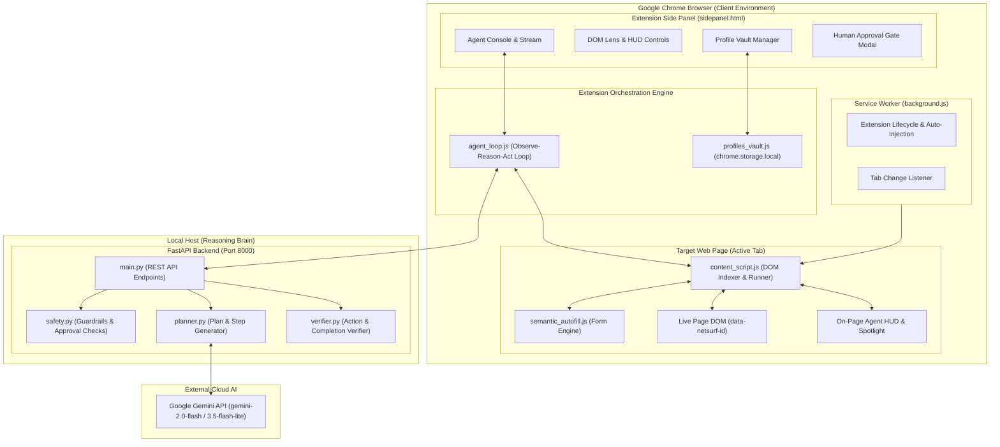

# NETSURF — Current Architecture Specification

**Date:** 2026-11-21  
**Architect:** Senior Software Architect  
**Architecture Version:** 1.0.0 (Manifest V3 + FastAPI Brain)

---

## 1. System Topology Overview

NetSurf's production architecture is centered on a **Chrome Extension Manifest V3** controlling live browser tabs directly from the user's **Chrome Side Panel**, delegating stateless reasoning and structured action planning to a local **FastAPI Backend**.



---

## 2. Component Interaction Matrix

| Source Component | Target Component | Protocol / Channel | Payload / Purpose |
| :--- | :--- | :--- | :--- |
| `sidepanel.js` | `agent_loop.js` | Direct JS API call | `start(goal, callbacks)`, `stop()`, `exportCsv()` |
| `sidepanel.js` | `profiles_vault.js` | Direct JS API call | `getAllProfiles()`, `saveProfile()`, `setActiveProfileId()` |
| `agent_loop.js` | `content_script.js` | `chrome.tabs.sendMessage` | `{type: "GET_OBSERVATION"}` → Returns interactive elements & page summary |
| `agent_loop.js` | `content_script.js` | `chrome.tabs.sendMessage` | `{type: "EXECUTE_ACTION", action, params}` → Clicks, types, scrolls, fills forms, extracts |
| `agent_loop.js` | `fastapi_backend` | HTTP `POST /agent/plan` | `{goal, observation}` → Returns structured `Plan` (phases, actions, criteria) |
| `agent_loop.js` | `fastapi_backend` | HTTP `POST /agent/step` | `{goal, history, observation, current_task}` → Returns next `Action` & `requires_approval` |
| `agent_loop.js` | `fastapi_backend` | HTTP `POST /agent/verify`| `{action_type, params, prev_obs, curr_obs}` → Returns `VerificationResult` |
| `agent_loop.js` | `fastapi_backend` | HTTP `POST /agent/validate_completion` | `{plan, extracted_data, history, export_generated}` → Returns `TaskValidationResult` |
| `content_script.js` | `semantic_autofill.js`| Direct JS API call | `semanticallyFillForm(data)` → Evaluates DOM inputs against canonical dictionary |
| `background.js` | `content_script.js` | `chrome.scripting.executeScript` | Injects `content_script.js` into tabs on load and install |
| `fastapi_backend` | Google Gemini API | HTTPS / Google GenAI SDK | Sends prompts with quarantined observation blocks, receives structured JSON |

---

## 3. Detailed Data Flow

### 3.1 Task Execution Flow: Observe → Reason → Act → Verify → Recover

```mermaid
sequenceDiagram
    autonumber
    actor User
    participant SidePanel as Side Panel UI
    participant Loop as agent_loop.js
    participant CS as content_script.js
    participant FastAPI as FastAPI Backend
    participant Gemini as Google Gemini API

    User->>SidePanel: Enter Goal & Click "Launch Agent"
    SidePanel->>Loop: start(goal)
    Loop->>CS: GET_OBSERVATION
    CS-->>Loop: Observation (URL, Title, Elements with IDs, Summary)
    Loop->>FastAPI: POST /agent/plan {goal, observation}
    FastAPI->>Gemini: Generate Structured Plan
    Gemini-->>FastAPI: Plan (Phases, Actions, Criteria)
    FastAPI-->>Loop: Structured Plan Object
    Loop->>SidePanel: onPlan(plan) -> Render Checklist

    loop For each planned action
        Loop->>CS: GET_OBSERVATION (Fresh state)
        CS-->>Loop: Observation
        Loop->>FastAPI: POST /agent/step {goal, history, observation, task}
        FastAPI->>FastAPI: Check CAPTCHA & Approval Gate
        FastAPI-->>Loop: StepResponse (action, requires_approval, reason)
        
        opt If requires_approval is TRUE
            Loop->>SidePanel: Display Human Approval Modal
            User->>SidePanel: Click "Approve Action"
            SidePanel-->>Loop: Approval Confirmed
        end

        Loop->>CS: EXECUTE_ACTION (action, params)
        CS->>CS: Spotlight DOM Element & Dispatch Events
        CS-->>Loop: Execution Result (success, data, count)
        
        Loop->>CS: GET_OBSERVATION (Post-action state)
        CS-->>Loop: CurrObservation
        Loop->>FastAPI: POST /agent/verify {action, prev_obs, curr_obs}
        FastAPI-->>Loop: VerificationResult (verified, confidence, message)
        
        alt Verification Failed
            Loop->>Loop: Retry counter increment & backoff delay
        else Verification Passed
            Loop->>SidePanel: onLog(step_entry) -> Update Checklist
        end
    end

    Loop->>FastAPI: POST /agent/validate_completion {plan, extracted_data, history}
    FastAPI-->>Loop: ValidationResult (completed / partial / failed)
    Loop->>SidePanel: Render Final Summary / Table
```

---

## 4. Network Topology & Ports

| Port | Service | Technology | Role | Status in Architecture |
| :---: | :---: | :---: | :---: | :---: |
| **8000** | NetSurf Reasoning Brain | Python / FastAPI / Uvicorn | Primary stateless reasoning brain for Chrome Extension | **Core Production Service** |
| **3000** | Legacy Node API | Node.js / Express / Playwright | Legacy standalone backend with Playwright runner & SQLite | **Legacy (To be retired)** |
| **3001** | Test Demo Site | Node.js / Express (static) | Serves `demo-site/` for local e-commerce test flows | **Test Tooling Only** |
| **5173** | Legacy Web Dashboard | React / Vite | Web frontend proxying to Port 3000 | **Legacy (To be retired)** |

---

## 5. State Management & Persistence Models

### 5.1 Client-Side Execution State (`agent_loop.js`)
The `AgentLoop` instance maintains strictly in-memory state during an active run:
- `this.isRunning`: Boolean lock guarding against concurrent runs.
- `this.activeTabId`: Tab currently under control.
- `this.plan`: Complete structured plan (`Plan` schema) with phases and planned tasks.
- `this.history`: Chronological execution array containing `step_number`, `thought`, `action`, `params`, `result`, and `timestamp`.
- `this.extractedRecords`: Array of structured JSON objects scraped from pages, each stamped with `source_url`.
- `this.exportGenerated`: Boolean flag indicating whether the user downloaded a CSV.

### 5.2 Browser Storage State (`profiles_vault.js`)
Backed by `chrome.storage.local`:
- `netsurf_autofill_profiles`: Array of profile objects.
  ```json
  [
    {
      "id": "prof_1700000000",
      "name": "Work Profile",
      "isDefault": true,
      "updatedAt": 1700000000000,
      "fields": {
        "fullName": "Jane Doe",
        "email": "jane@example.com",
        "company": "Acme Corp",
        "position": "Engineer"
      }
    }
  ]
  ```
- `netsurf_active_profile_id`: String containing the active profile's `id`.

### 5.3 Backend Stateless Request Lifecycle (`fastapi_backend`)
- FastAPI holds **zero server-side session state**.
- Every request to `/agent/step` or `/agent/verify` is self-contained, receiving the goal, history log, and current DOM observation.
- Enables complete horizontal scalability and zero database corruption risks.
