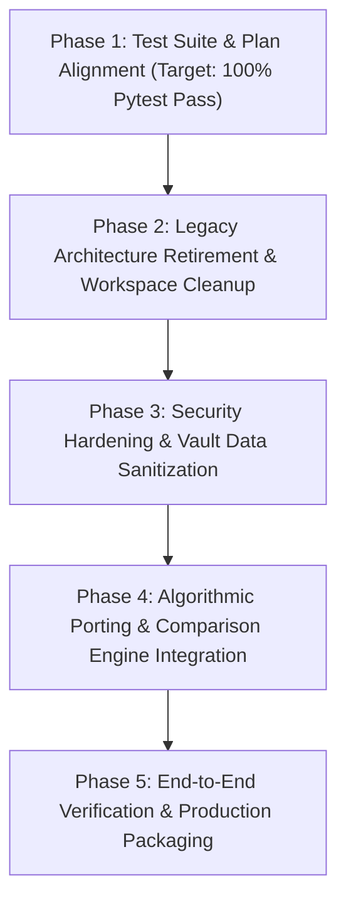

# NETSURF — Final Implementation Roadmap

**Date:** 2026-11-21  
**Architect:** Senior Software Architect  
**Objective:** Deliver a production-grade, hardened Agentic Chrome Extension and FastAPI Reasoning Brain while strictly adhering to architectural constraints.

---

## 1. Architectural Guardrails & Constraints

Every phase of this roadmap strictly observes the following non-negotiable rules:
1. **Chrome Extension Form Factor:** NetSurf must remain a Chrome extension (Manifest V3).
2. **Side Panel Primary Interface:** The Chrome Side Panel (`sidepanel.html`) remains the exclusive user interface.
3. **No External Web Dashboard:** No separate website frontend (React dashboard in `frontend/` is retired).
4. **FastAPI Sole Brain:** FastAPI on Port 8000 remains the single reasoning backend. No secondary backend (Node.js in `backend/` is retired).
5. **No Loop Rewrite:** The proven Observe → Reason → Act → Verify → Recover → Learn agent loop in `agent_loop.js` must be preserved and reused.
6. **Feature Preservation:** All existing semantic autofill, CSV extraction, approval gating, and CAPTCHA protections must be preserved.
7. **Profile Vault Continuity:** Preserve local autofill profile management in `chrome.storage.local` while sanitizing demonstration data.
8. **Secrets Security:** Never print or leak API keys, credentials, or secrets in code, logs, or UI.

---

## 2. Phased Implementation Roadmap

---

### Phase 1: Test Suite & Plan Alignment (Immediate Fix)

**Goal:** Reconcile plan decomposition in `fastapi_backend/planner.py` with test expectations in `tests/` to achieve 38/38 passing tests (100% pass rate).

- [ ] **1.1 Align Multi-Page Extraction Plan (`planner.py`):**
  - Update `build_structured_plan()` for extraction goals (e.g. `books.toscrape.com`) to generate 4 structured phases:
    1. Content Discovery & Navigation
    2. Data Extraction & Normalization
    3. Pagination & Multi-Page Traversal
    4. Dataset Verification & Completion
  - Include the 15 discrete executable action steps expected by `test_case_1_all_15_actions_succeed`, `test_case_4`, and `test_case_6` in [tests/test_execution_engine.py](file:///d:/Netsurf/tests/test_execution_engine.py).
  - Ensure Action 8 is marked as an optional scroll action (`required: false`) so skipping logic verifies cleanly.
- [ ] **1.2 Align Research & Shopping Plan (`planner.py`):**
  - Update `build_structured_plan()` for product/research queries to produce 4 phases and at least 8 actions as asserted in [tests/test_daily_tasks.py](file:///d:/Netsurf/tests/test_daily_tasks.py).
  - Verify `require_source_urls: true` is set on `completion_criteria`.
- [ ] **1.3 Validate Suite:**
  - Execute `python -m pytest tests/ -v`.
  - Confirm all 38 unit tests pass cleanly (28 backend + 2 daily tasks + 8 execution engine).

---

### Phase 2: Legacy Architecture Retirement & Workspace Cleanup

**Goal:** Cleanly decouple and retire the uncalled Node.js backend (`backend/`) and React dashboard (`frontend/`), making the repository lean, self-contained, and compliant.

- [ ] **2.1 Extract Reusable Logic from Node.js Backend:**
  - Copy candidate ranking heuristics (`validateJobRelevance`, `compareAndRankProducts`) from `backend/src/services/comparisonEngine.js` before retirement.
- [ ] **2.2 Archive Legacy Folders:**
  - Move or archive `backend/` and `frontend/` into an `archive/` or `.legacy/` directory (or remove from active build tracking).
  - Remove orphaned SQLite files (`netsurf.db`, `netsurf.db-shm`, `netsurf.db-wal`).
- [ ] **2.3 Remove Redundant Configuration Files:**
  - Delete `backend/run_fastapi.py`.
  - Delete `backend/requirements.txt`.
  - Ensure only root `requirements.txt`, `run_fastapi.py`, and `start_backend.bat` remain as entry points.
- [ ] **2.4 Preserve Demo Site for Local Testing:**
  - Keep `demo-site/` (static HTML/CSS/JS) as a lightweight local test target for testing form autofill and consequential checkout approval gates.
  - Add a lightweight Python HTTP server command or FastAPI static mount for `demo-site` so Node.js is not needed to serve it.

---

### Phase 3: Security Hardening & Vault Data Sanitization

**Goal:** Remediate all high and medium security vulnerabilities identified in the audit.

- [ ] **3.1 Restrict FastAPI CORS Middleware (`fastapi_backend/main.py`):**
  - Replace `allow_origins=["*"]` with an explicit origin configuration matching local extension origins (`chrome-extension://*`) and local hosts (`http://127.0.0.1:*`, `http://localhost:*`).
  - Disable `allow_credentials=True` when open wildcards are present.
- [ ] **3.2 Sanitize Demonstration Data (`extension/profiles_vault.js`):**
  - Replace personal identities ("Rahul Sharma" with Gurugram address, "Priya Patel" with Mumbai address) with neutral generic template examples:
    - Default Work Profile: `Jane Doe`, `Work Inc.`, `100 Enterprise Way, Suite 200, Tech City, TC 10001`, `jane.doe@example.com`, `+1 555-0100`.
    - Default Personal Profile: `John Smith`, `456 Community Drive, Apt 4B, Metro City, MC 20002`, `john.smith@example.com`, `+1 555-0101`.
  - Retain all CRUD functionality, active profile switching, and prompt data saving banner.
- [ ] **3.3 Secure DOM Rendering in Side Panel (`extension/sidepanel.js`):**
  - Implement HTML escaping for dynamic log entries and page text summaries before rendering into `innerHTML` to eliminate DOM-based XSS risks from untrusted external websites.
- [ ] **3.4 Clean Virtual Environment Configuration:**
  - Rebuild or update the virtual environment `.venv` to remove hardcoded machine-specific paths (`C:\Users\Shivin\...`).

---

### Phase 4: Algorithmic Porting & Comparison Engine Integration

**Goal:** Enhance the FastAPI reasoning brain by porting the proven comparison and ranking algorithms into Python modules.

- [ ] **4.1 Create `fastapi_backend/ranking.py`:**
  - Implement Python versions of:
    - `validate_job_relevance(candidate, criteria)`: Strict role filtering preventing cross-domain contamination.
    - `rank_products_by_constraints(products, max_price, min_ram)`: Evaluates hardware constraints and sorts passing candidates by budget.
- [ ] **4.2 Integrate Ranking into Step Synthesis:**
  - Call `ranking.py` when evaluating extracted records during `extract` or `done` actions to produce verified recommendations with transparent rationale and trade-offs.
- [ ] **4.3 Configurable Backend Endpoint:**
  - Add an options setting in the Side Panel or `chrome.storage.local` allowing users to configure the FastAPI backend URL (defaulting to `http://127.0.0.1:8000`), avoiding hardcoded endpoint strings.

---

### Phase 5: End-to-End Verification & Production Packaging

**Goal:** Verify full system reliability across end-to-end scenarios and package the Chrome extension.

- [ ] **5.1 End-to-End Test Execution (`tests/e2e/run_e2e_tests.py`):**
  - Run the 4 core scenarios:
    1. Single-Page Search & Navigation (Wikipedia)
    2. Multi-Page Structured Scraping & CSV Export (Books to Scrape)
    3. Consequential Action Human Approval Gate (Checkout & Purchase)
    4. Unreachable Domain Error Recovery & Graceful Halt
  - Verify and record performance in `tests/e2e/RESULTS.md`.
- [ ] **5.2 Manual Browser Verification:**
  - Load unpacked `extension/` in Google Chrome (`chrome://extensions`).
  - Open Side Panel and verify:
    - Backend health indicator is green (`Connected`).
    - Quick intent chips populate prompts correctly.
    - 1-Click Instant Autofill works smoothly against test forms in `demo-site`.
    - CSV Export generates well-formed files with UTF-8 BOM.
    - Human approval modal interrupts consequential clicks.
- [ ] **5.3 Release Packaging:**
  - Run `create_zip.py` to produce a clean, production-ready distribution zip without virtual environments, caches, or legacy artifacts.

---

## 3. Success Metrics

| Milestone | Metric | Target |
| :--- | :--- | :---: |
| **Unit Test Coverage** | Pytest passing rate across all test files | **100% (38/38)** |
| **E2E Success Rate** | Multi-page extraction, search, approval, recovery | **100% (4/4)** |
| **Security Posture** | Open CORS wildcards & personal demonstration data | **0 Vulnerabilities** |
| **Architectural Purity** | Dependency on Node.js / React website dashboard | **0 (Full Extension + FastAPI)** |
| **CSV Export Quality** | RFC-4180 compliance with source URLs and UTF-8 BOM | **100% Valid** |
